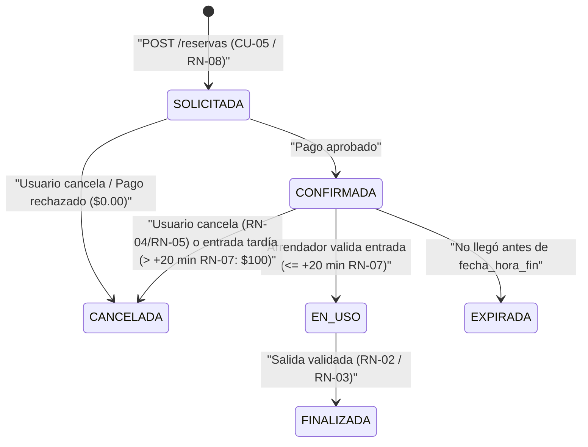

# Especificación Técnica — Módulo 03: Reservaciones, Máquina de Estados y Penalizaciones (`03-reservas`)

---

## 1. Resumen y Alcance

Este módulo implementa el ciclo de vida completo de las reservaciones de espacios de estacionamiento en **ParkShare_Backend**: creación validada con control de concurrencia, disponibilidad horaria y reserva única activa (**CU-05**, **RN-08**), máquina de estados estricta, cálculo de monto base, tolerancia de entrada con cancelación y multa automática (**RN-07**), tolerancia de salida, recargos por retraso y multas por cancelación tardía (**RN-01 a RN-08**).

### Alcance incluido
- Modelo `reserva` con integridad referencial hacia `usuario` (Módulo `01-auth`) y `cochera` (Módulo `02-cocheras`).
- Validación de duración en bloques exactos de 30 minutos hasta 24 horas (**RN-01**), cobertura dentro de la tabla `disponibilidad`, restricción de **1 reserva activa simultánea por arrendatario** (**RN-08**) y verificación atómica de cupo contra `espacios_totales` mediante bloqueo pesimista (`select_for_update`).
- Máquina de estados finitos (`SOLICITADA`, `CONFIRMADA`, `EN_USO`, `FINALIZADA`, `CANCELADA`, `EXPIRADA`) con matriz estricta de transiciones y permisos por rol.
- Cálculo determinista de penalizaciones y tolerancias:
  - Tolerancia de `20` minutos en la hora de entrada (**RN-07**): si se supera el límite (`> fecha_hora_inicio + 20 min`), cancelación automática de la reserva con multa fija de `$100.00 MXN` (`10 min` entre `+10` y `+20` a `$10.00 MXN/min`).
  - Cancelación gratuita `<= 10` minutos tras creación (**RN-04**) y multa de `$100.00 MXN` posterior (**RN-05**).
  - Tolerancia de `10` minutos al término de la reserva (**RN-02**) y recargo de `$10.00 MXN` por minuto adicional (**RN-03**).
- Endpoints de creación, listado segmentado por rol (`Próximas`/`Anteriores` para arrendatario; `Próximas llegadas`/`En uso` para arrendador), detalle con cálculo en vivo de tiempo restante/retraso, cancelación y actualización controlada de estado.
- Integración con `02-cocheras` para reflejar ocupación real en `espacios_disponibles_ahora` de `GET /cocheras`.

### Fuera de alcance en este módulo (puntos de integración)
- Procesamiento de cobros (`pago` / **CU-06**) y generación/escaneo criptográfico SHA-256 de códigos QR (`codigo_qr` / **CU-07** / **RN-06**), los cuales pertenecen a módulos posteriores e invocarán los servicios `confirm_reservation`, `start_reservation_usage` y `finish_reservation` definidos en este módulo.

---

## 2. Casos de Uso Cubiertos (CIM)

| ID | Nombre | Actor | Descripción |
| :--- | :--- | :--- | :--- |
| **CU-05** | Reservar cochera | Arrendatario (`ACTIVA`) | El arrendatario selecciona una cochera aprobada, fecha, hora de inicio y hora de fin dentro del horario disponible. El sistema valida duración (`RN-01`), disponibilidad real y cupo, calcula `monto_base` y registra la reserva en estado inicial `SOLICITADA`. *(Incluye conceptualmente CU-06 Pago y CU-07 QR en módulos posteriores.)* |

---

## 3. Reglas de Negocio Aplicables (`RN-XX`)

| Regla | Fórmula / Lógica exacta |
| :--- | :--- |
| **RN-01** (Duración de la reservación) | `fecha_hora_fin > fecha_hora_inicio`. Sea $\Delta s = (\text{fecha\_hora\_fin} - \text{fecha\_hora\_inicio})$ en segundos: debe cumplirse $1800 \le \Delta s \le 86400$ (mínimo 30 minutos, máximo 24 horas) y $\Delta s \bmod 1800 = 0$ (bloques exactos de 30 minutos, sin segundos residuales). |
| **RN-02** (Tiempo de tolerancia) | Al finalizar el tiempo reservado, se otorgan **10 minutos de tolerancia sin cargo** hasta $\text{limite\_tolerancia} = \text{fecha\_hora\_fin} + 10\text{ minutos}$ (si $\text{hora\_salida\_real} \le \text{limite\_tolerancia}$, el recargo es `$0.00 MXN`). **Al superar los 10 minutos de tolerancia** ($\text{hora\_salida\_real} > \text{limite\_tolerancia}$), empieza a cobrarse **`$10.00 MXN` por cada minuto** que el arrendatario tarde en retirar su vehículo (ver **RN-03**). |
| **RN-03** (Recargo por retraso) | Si $\text{hora\_salida\_real} > \text{limite\_tolerancia}$, sea $\text{exceso\_seg} = (\text{hora\_salida\_real} - \text{limite\_tolerancia})$ en segundos. Los minutos de retraso se calculan como $\text{minutos\_retraso} = \lceil \text{exceso\_seg} / 60 \rceil$, y el recargo es $\text{minutos\_retraso} \times \$10.00\text{ MXN}$ (ej. 10 minutos exactos después de la tolerancia = `$100.00 MXN`; 1 segundo después de la tolerancia = 1 minuto = `$10.00 MXN`). |
| **RN-04** (Cancelación sin costo) | Si se cancela dentro de los primeros 10 minutos posteriores a la creación ($\text{ahora} - \text{fecha\_creacion} \le 10\text{ minutos}$), `monto_penalizacion = 0.00`. |
| **RN-05** (Multa por cancelación tardía) | Si la reserva está en estado `CONFIRMADA` y se cancela después de los 10 minutos ($\text{ahora} - \text{fecha\_creacion} > 10\text{ minutos}$), `monto_penalizacion = 100.00` (`$100.00 MXN`). Si la reserva aún estaba en `SOLICITADA` (sin pago confirmado), la cancelación mantiene `monto_penalizacion = 0.00`. |
| **RN-06** (QR de salida - punto de integración) | La transición `EN_USO -> FINALIZADA` registra `hora_salida_real` y ejecuta el cálculo de `RN-02`/`RN-03`; al integrarse el módulo de QR, esta transición será disparada tras validar el QR de salida. |
| **RN-07** (Tolerancia de entrada y cancelación automática por llegada tardía) | Al registrar la entrada (`CONFIRMADA -> EN_USO`, tanto en `PATCH /reservas/{id}` / `start_reservation_usage` como al escanear el QR de `ENTRADA` en `POST /reservas/validar`), el arrendatario tiene una tolerancia de **20 minutos** desde su hora reservada: $\text{limite\_entrada} = \text{fecha\_hora\_inicio} + 20\text{ minutos}$ (ej. entrada reservada a las `14:00`: hasta las `14:20:00` ingresa normalmente a `EN_USO`). Si intenta ingresar después del límite ($\text{ahora} > \text{limite\_entrada}$, ej. `14:20:01` o `14:21:00`), la reservación **se cancela automáticamente** (`estado = 'CANCELADA'`) con una multa fija de **`$100.00 MXN`** (`monto_penalizacion = 100.00`), correspondiente a los 10 minutos entre `fecha_hora_inicio + 10 min` (`14:10`) y `fecha_hora_inicio + 20 min` (`14:20`) a `$10.00 MXN/min`. La cancelación y multa quedan persistidas en BD y el endpoint responde **`409 Conflict`** informando el motivo. *(Si al escanear QR de entrada ya se superó `qr.expiracion` = `fecha_hora_fin`, prevalece `410 Gone` del Módulo `04-qr-acceso`.)* |
| **RN-08** (Una sola reservación activa por arrendatario) | Un `ARRENDATARIO` solo puede tener **1 reservación activa a la vez** (estados `'SOLICITADA'`, `'CONFIRMADA'` o `'EN_USO'`), ya sea en la misma cochera o en cualquier otra cochera distinta. Si ya posee una reservación activa e intenta crear otra (`POST /reservas`), se rechaza con **`409 Conflict`** hasta que la reservación vigente termine (`'FINALIZADA'`, `'CANCELADA'` o `'EXPIRADA'`). |

### 3.1 Reglas Complementarias de Validación Horaria y Capacidad
1. **Cálculo de `monto_base`**:
   $$\text{monto\_base} = \text{round}\left(\text{cochera.tarifa\_hora} \times \frac{\text{duracion\_minutos}}{60},\ 2\right)$$
2. **Validación contra `disponibilidad`** (en zona horaria `America/Mexico_City`):
   - **Reserva en el mismo día calendario**: debe existir una franja en `disponibilidad` para el `dia_semana` correspondiente tal que `hora_inicio <= inicio.time()` y `fin.time() <= hora_fin`.
   - **Reserva que cruza medianoche (hasta 24 h)**: el día inicial $D$ debe tener cobertura hasta el cierre del día (`hora_fin >= 23:59:00`) desde `inicio.time()`, y el día siguiente $D+1$ debe tener cobertura desde apertura (`hora_inicio == 00:00:00`) hasta `fin.time()`. (Si dura exactamente 24 h desde las `00:00`, el día $D$ debe cubrir `00:00` a `23:59`).
3. **Verificación de cupo (`espacios_totales`)**:
   - Estados que ocupan un cajón en un intervalo: `('SOLICITADA', 'CONFIRMADA', 'EN_USO')`.
   - Dos intervalos $[A_{\text{ini}}, A_{\text{fin}})$ y $[B_{\text{ini}}, B_{\text{fin}})$ se traslapan si y solo si $A_{\text{ini}} < B_{\text{fin}} \land A_{\text{fin}} > B_{\text{ini}}$ (reservas contiguas como `10:00-11:00` y `11:00-12:00` **no** se traslapan).
   - El conteo se realiza dentro de `transaction.atomic()` bloqueando la fila de `cochera` con `select_for_update()`. Debe cumplirse `reservas_traslapadas < cochera.espacios_totales`.
4. **Prohibición de auto-reserva y reserva en el pasado**:
   - `fecha_hora_inicio` debe ser `>= timezone.now()`.
   - El dueño de la cochera (`cochera.arrendador_id == usuario.id_usuario`) no puede reservar su propia cochera (`400 Bad Request` / `403 Forbidden`).
5. **Unicidad de reserva activa por arrendatario (`RN-08`)**:
   - Dentro de `transaction.atomic()`, antes de validar cupo y crear la reserva, se bloquea la fila del `Usuario` arrendatario con `select_for_update()` (para serializar peticiones concurrentes del mismo usuario) y se verifica que `Reserva.objects.filter(arrendatario=tenant, estado__in=('SOLICITADA', 'CONFIRMADA', 'EN_USO')).exists()` sea `False`. Si ya tiene una reserva activa, se rechaza con **`409 Conflict`**.
6. **Persistencia transaccional en cancelación automática por llegada tardía (`RN-07`)**:
   - Cuando `start_reservation_usage` (o `_execute_transition` hacia `EN_USO`) detecta `ahora > fecha_hora_inicio + 20 minutos`, la actualización a `estado = 'CANCELADA'` y `monto_penalizacion = Decimal('100.00')` debe quedar **confirmada (commit) en base de datos** antes de retornar `409 Conflict` (`ConflictError`). Ningún `transaction.atomic()` externo debe revertir dicho guardado al capturar la excepción. En `POST /reservas/validar` (QR de `ENTRADA`), el QR no se marca como `usado = True` ni se emite QR de `SALIDA`.

### 3.2 Máquina de Estados de `Reserva`



#### Matriz de Transiciones Permitidas y Permisos

| Origen | Destino | Quién puede ejecutarla | Reglas / Efectos |
| :--- | :--- | :--- | :--- |
| `SOLICITADA` | `CONFIRMADA` | `ADMIN` / Servicio de Pagos | Confirma pago aprobado. |
| `SOLICITADA` | `CANCELADA` | `ARRENDATARIO` dueño / `ADMIN` / Servicio Pagos | `monto_penalizacion = 0.00`. |
| `CONFIRMADA` | `EN_USO` | `ARRENDADOR` dueño / `ADMIN` | Solo si `ahora <= fecha_hora_inicio + 20 minutos` (`RN-07`) y `ahora <= fecha_hora_fin`. Si `ahora > fecha_hora_inicio + 20 minutos`, cancela automáticamente con `$100.00` y retorna `409 Conflict`. |
| `CONFIRMADA` | `CANCELADA` | `ARRENDATARIO` dueño / `ADMIN` / Sistema (`RN-07`) | Aplica `RN-04` (`<= 10 min` -> `$0.00`), `RN-05` (`> 10 min` -> `$100.00`) o cancelación automática `RN-07` por entrada tardía (`$100.00`). |
| `CONFIRMADA` | `EXPIRADA` | `ARRENDADOR` dueño / `ADMIN` / Sistema | Solo si `ahora > fecha_hora_fin` (no-show). |
| `EN_USO` | `FINALIZADA` | `ARRENDADOR` dueño / `ADMIN` | Fija `hora_salida_real` (`>= fecha_hora_inicio`), calcula `RN-02`/`RN-03` y guarda `monto_penalizacion`. |

> Cualquier transición no listada en la tabla (ej. desde `FINALIZADA`, `CANCELADA`, `EXPIRADA`, o saltos como `SOLICITADA -> EN_USO`, `CONFIRMADA -> FINALIZADA`) responde **`409 Conflict`**. Si el rol del usuario autenticado no tiene permiso para ejecutar esa transición específica, responde **`403 Forbidden`**.

---

## 4. Modelo de Datos (Diccionario de Datos / PSM)

### 4.1 Tabla `reserva`

| Columna (`db_column`) | Tipo SQL / MySQL | Nulidad | Restricciones / Default | Descripción |
| :--- | :--- | :--- | :--- | :--- |
| `id_reserva` | `BIGINT AUTO_INCREMENT` | NO NULO | `PK` | Identificador único de la reservación. |
| `arrendatario_id` | `BIGINT` | NO NULO | `FK -> usuario.id_usuario` (`ON DELETE RESTRICT`), `INDEX` | Arrendatario que solicita la reserva. |
| `cochera_id` | `BIGINT` | NO NULO | `FK -> cochera.id_cochera` (`ON DELETE RESTRICT`), `INDEX` | Cochera reservada. |
| `fecha_hora_inicio` | `DATETIME` | NO NULO | Dentro de `disponibilidad` | Fecha y hora de inicio reservada. |
| `fecha_hora_fin` | `DATETIME` | NO NULO | Múltiplo 30 min (`30m` a `24h`) | Fecha y hora de término reservada. |
| `hora_salida_real` | `DATETIME` | SÍ NULO | Default `NULL` hasta checkout | Marca temporal real de salida (`RN-02`/`RN-03`). |
| `monto_base` | `DECIMAL(8, 2)` | NO NULO | `> 0` | Costo base (`tarifa_hora * horas_reservadas`). |
| `monto_penalizacion` | `DECIMAL(8, 2)` | NO NULO | Default `0.00`, `>= 0` | Monto por retardo (`RN-03`) o cancelación tardía (`RN-05`). |
| `estado` | `ENUM('SOLICITADA', 'CONFIRMADA', 'EN_USO', 'FINALIZADA', 'CANCELADA', 'EXPIRADA')` | NO NULO | Default `'SOLICITADA'`, `INDEX` | Estado actual de la máquina de estados. |
| `fecha_creacion` | `DATETIME` | NO NULO | `auto_now_add=True` | Timestamp de creación (referencia para `RN-04` y `RN-05`). |

> **Índices compuestos recomendados**:
> - `(cochera_id, estado, fecha_hora_inicio, fecha_hora_fin)` para consultas rápidas de traslape de cupo.
> - `(arrendatario_id, estado, fecha_hora_inicio)` para listados de usuario.

### 4.2 Diagrama ER Simplificado
```
usuario (1) ──────< (N) reserva
cochera (1) ──────< (N) reserva
```

---

## 5. Contratos de API REST (Endpoints)

### 5.1 `POST /reservas`
- **Autenticación y Permisos**: JWT requerido (`IsAuthenticated`, `IsActiveTenant`: `rol == 'ARRENDATARIO'` y `estado_cuenta == 'ACTIVA'`).
- **Descripción**: Crea una reserva en estado `SOLICITADA` (**CU-05**), validando cochera `APROBADA`, **RN-01**, **RN-08** (que el arrendatario no tenga otra reserva activa en `SOLICITADA`, `CONFIRMADA` o `EN_USO`), horario de `disponibilidad` y cupo atómico disponible.

#### Request Payload
```json
{
  "cochera_id": 10,
  "fecha_hora_inicio": "2026-11-20T10:00:00-06:00",
  "fecha_hora_fin": "2026-11-20T11:30:00-06:00"
}
```

#### Respuestas
- **`201 Created`** (Ejemplo con `tarifa_hora = 45.00` y duración 1.5 h):
```json
{
  "id_reserva": 101,
  "arrendatario_id": 1,
  "cochera_id": 10,
  "fecha_hora_inicio": "2026-11-20T10:00:00-06:00",
  "fecha_hora_fin": "2026-11-20T11:30:00-06:00",
  "hora_salida_real": null,
  "monto_base": "67.50",
  "monto_penalizacion": "0.00",
  "monto_total": "67.50",
  "estado": "SOLICITADA",
  "fecha_creacion": "2026-11-19T16:00:00-06:00"
}
```
- **`400 Bad Request`**: `fecha_hora_inicio` en el pasado, violación de `RN-01` (ej. 15 min, 45 min, 25 h), horario fuera de `disponibilidad`, o intento de reservar cochera propia.
- **`403 Forbidden`**: Usuario no es `ARRENDATARIO` o cuenta no está `ACTIVA`.
- **`404 Not Found`**: `cochera_id` inexistente.
- **`409 Conflict`**: La cochera no está en estado `APROBADA`, el arrendatario ya tiene una reservación activa en curso (**RN-08**), o no hay cupo disponible (`espacios_totales` saturados en ese traslape):
```json
{
  "detail": "Ya cuentas con una reservación activa. Debes finalizarla o cancelarla antes de reservar otra cochera."
}
```

---

### 5.2 `GET /reservas`
- **Autenticación y Permisos**: JWT requerido (`IsAuthenticated`, `IsActiveAccount`, roles `ARRENDATARIO` o `ARRENDADOR`).
- **Query Params**:
  - `vista` (opcional):
    - Para `ARRENDATARIO`:
      - `proximas`: reservas en `SOLICITADA`, `CONFIRMADA`, `EN_USO` (ordenadas por `fecha_hora_inicio` ascendente).
      - `anteriores`: reservas en `FINALIZADA`, `CANCELADA`, `EXPIRADA` (ordenadas por `fecha_hora_inicio` descendente).
    - Para `ARRENDADOR` (reservas sobre sus cocheras):
      - `proximas_llegadas`: reservas en `CONFIRMADA` (ordenadas por `fecha_hora_inicio` ascendente).
      - `en_uso`: reservas en `EN_USO` (ordenadas por `fecha_hora_fin` ascendente).
      - `historial`: reservas en `FINALIZADA`, `CANCELADA`, `EXPIRADA`.
  - `estado` (opcional): filtro directo por estado exacto.
- **Respuestas**:
  - **`200 OK`**:
```json
{
  "count": 1,
  "results": [
    {
      "id_reserva": 101,
      "cochera": {
        "id_cochera": 10,
        "nombre": "Cochera Los Pinos",
        "direccion": "Av. Insurgentes Sur 1450, Col. Actipan, C.P. 03230"
      },
      "arrendatario": {
        "id_usuario": 1,
        "nombre_completo": "Ana Sofía Martínez López",
        "placas": "ABC-123-D",
        "modelo_vehiculo": "Nissan Versa 2022"
      },
      "fecha_hora_inicio": "2026-11-20T10:00:00-06:00",
      "fecha_hora_fin": "2026-11-20T11:30:00-06:00",
      "estado": "CONFIRMADA",
      "monto_base": "67.50",
      "monto_penalizacion": "0.00",
      "monto_total": "67.50"
    }
  ]
}
```
  - **`400 Bad Request`**: Valor de `vista` incompatible con el rol o inválido.

---

### 5.3 `GET /reservas/{id}`
- **Autenticación y Permisos**: JWT requerido (`IsAuthenticated`, solo `arrendatario` de la reserva, `arrendador` dueño de la cochera o `ADMIN`). Otros usuarios reciben `403 Forbidden`.
- **Respuestas**:
  - **`200 OK`**:
```json
{
  "id_reserva": 101,
  "estado": "EN_USO",
  "fecha_hora_inicio": "2026-11-20T10:00:00-06:00",
  "fecha_hora_fin": "2026-11-20T11:30:00-06:00",
  "hora_salida_real": null,
  "fecha_creacion": "2026-11-19T16:00:00-06:00",
  "desglose_montos": {
    "monto_base": "67.50",
    "monto_penalizacion": "0.00",
    "monto_total": "67.50",
    "recargo_estimado_actual": "0.00"
  },
  "tiempo_en_uso": {
    "tiempo_restante_minutos": 25,
    "en_tolerancia": false,
    "minutos_retraso_actual": 0
  },
  "cochera": {
    "id_cochera": 10,
    "nombre": "Cochera Los Pinos",
    "direccion": "Av. Insurgentes Sur 1450, Col. Actipan, C.P. 03230",
    "tarifa_hora": "45.00"
  },
  "arrendatario": {
    "id_usuario": 1,
    "nombre_completo": "Ana Sofía Martínez López",
    "placas": "ABC-123-D",
    "modelo_vehiculo": "Nissan Versa 2022"
  }
}
```
*(Cuando `estado != 'EN_USO'`, `tiempo_en_uso` es `null`. Si `estado == 'EN_USO'` y ya pasó `fecha_hora_fin`, `tiempo_restante_minutos = 0`, `en_tolerancia = true` durante los 10 min de `RN-02`, y luego `en_tolerancia = false` con `minutos_retraso_actual` y `recargo_estimado_actual` según `RN-03`.)*

---

### 5.4 `POST /reservas/{id}/cancelar`
- **Autenticación y Permisos**: JWT requerido (`IsAuthenticated`, `arrendatario` dueño de la reserva o `ADMIN`).
- **Descripción**: Cancela la reserva desde `SOLICITADA` o `CONFIRMADA`, aplicando **RN-04** (`$0.00`) o **RN-05** (`$100.00`).
- **Respuestas**:
  - **`200 OK`**:
```json
{
  "mensaje": "Reserva cancelada con multa por cancelación tardía.",
  "id_reserva": 101,
  "estado": "CANCELADA",
  "monto_base": "67.50",
  "monto_penalizacion": "100.00",
  "aplico_multa_tardia": true
}
```
  - **`403 Forbidden`**: Usuario no es dueño de la reserva ni `ADMIN`.
  - **`404 Not Found`**: Reserva inexistente.
  - **`409 Conflict`**: La reserva está en `EN_USO`, `FINALIZADA`, `CANCELADA` o `EXPIRADA`.

---

### 5.5 `PATCH /reservas/{id}`
- **Autenticación y Permisos**: JWT requerido (`IsAuthenticated`, sujeto a la matriz de roles por transición).
- **Descripción**: Ejecuta una transición controlada de la máquina de estados (incluyendo cancelación con `RN-04`/`RN-05`, inicio de uso sujeto a tolerancia de 20 min de `RN-07` o finalización con cálculo de `RN-02`/`RN-03`).

#### Request Payload — Ejemplo de finalización (`EN_USO -> FINALIZADA`)
```json
{
  "estado": "FINALIZADA",
  "hora_salida_real": "2026-11-20T11:50:00-06:00"
}
```
*(Si se omite `hora_salida_real` al finalizar, el servidor utiliza `timezone.now()`.)*

#### Respuestas
- **`200 OK`** (Ejemplo: `fecha_hora_fin = 11:30`, `hora_salida_real = 11:50` -> 10 min tolerancia hasta `11:40` + 10 min retraso = `$100.00`):
```json
{
  "id_reserva": 101,
  "estado": "FINALIZADA",
  "fecha_hora_inicio": "2026-11-20T10:00:00-06:00",
  "fecha_hora_fin": "2026-11-20T11:30:00-06:00",
  "hora_salida_real": "2026-11-20T11:50:00-06:00",
  "monto_base": "67.50",
  "monto_penalizacion": "100.00",
  "monto_total": "167.50"
}
```
- **`400 Bad Request`**: `estado` desconocido o `hora_salida_real < fecha_hora_inicio`.
- **`403 Forbidden`**: Actor autenticado sin permiso para esa transición (ej. arrendatario intentando pasar a `CONFIRMADA`, `EN_USO` o `FINALIZADA`; arrendador intentando cancelar reserva de cliente o aprobar pago).
- **`409 Conflict`**: Transición prohibida por la máquina de estados (ej. `SOLICITADA -> EN_USO`, `FINALIZADA -> CANCELADA`, `CONFIRMADA -> EXPIRADA` antes de `fecha_hora_fin`), o **llegada tardía fuera de tolerancia (`RN-07`)** al intentar pasar `CONFIRMADA -> EN_USO` después de `fecha_hora_inicio + 20 min` (evento que también aplica al escanear QR de `ENTRADA` en `POST /reservas/validar`):
```json
{
  "detail": "Se excedió la tolerancia de 20 minutos para la entrada. La reservación fue cancelada automáticamente con una multa de $100.00 MXN.",
  "error": "LateEntryCancelled",
  "estado_reserva": "CANCELADA",
  "monto_penalizacion": "100.00"
}
```

---

## 6. Escenarios de Prueba para TDD

### 6.1 Casos Felices (Happy Path)
1. **Creación exitosa (`CU-05`, `RN-01`)**: Reserva de 90 min (`1.5 h`) en cochera `APROBADA` con tarifa `$45.00` dentro de `disponibilidad` y con cupo libre -> `201 Created`, `estado='SOLICITADA'`, `monto_base='67.50'`, `monto_penalizacion='0.00'`.
2. **Transición completa feliz**: `SOLICITADA -> CONFIRMADA -> EN_USO -> FINALIZADA` con salida antes de `fecha_hora_fin` -> `hora_salida_real` registrada y `monto_penalizacion='0.00'`.
3. **Salida dentro de tolerancia (`RN-02`)**: Reserva termina a las `12:00`; salida a las `12:08` y salida exacta a las `12:10:00` -> `monto_penalizacion='0.00'`.
4. **Salida con retraso (`RN-03`)**: Reserva termina a las `12:00`; salida a las `12:20:00` (10 min después de tolerancia) -> `monto_penalizacion='100.00'` (`monto_total = monto_base + 100.00`).
5. **Cancelación gratuita (`RN-04`)**: Reserva `CONFIRMADA` cancelada a los 5 min (y exactamente a los 10 min 00 s) de `fecha_creacion` -> `estado='CANCELADA'`, `monto_penalizacion='0.00'`.
6. **Cancelación tardía (`RN-05`)**: Reserva `CONFIRMADA` cancelada a los 10 min 01 s (o 25 min) de `fecha_creacion` -> `estado='CANCELADA'`, `monto_penalizacion='100.00'`.
7. **Listados por rol y vista (`GET /reservas`)**: Arrendatario ve `proximas` y `anteriores`; Arrendador ve `proximas_llegadas` y `en_uso` exclusivamente de sus cocheras.
8. **Detalle con cálculo en vivo (`GET /reservas/{id}`)**: Reserva `EN_USO` muestra `tiempo_restante_minutos`, `en_tolerancia` o `minutos_retraso_actual` y `recargo_estimado_actual` correctos.
9. **Integración con `02-cocheras`**: Una reserva `CONFIRMADA`/`EN_USO` vigente reduce `espacios_disponibles_ahora` en `GET /cocheras`.
10. **Entrada dentro de tolerancia (`RN-07`)**: Reserva `CONFIRMADA` con `fecha_hora_inicio = 14:00` registra entrada a las `14:15:00` o exactamente a las `14:20:00` (`PATCH /reservas/{id}` y `POST /reservas/validar` con QR de `ENTRADA`) -> transiciona a `EN_USO` con `monto_penalizacion = '0.00'`.
11. **Nueva reserva tras concluir reserva previa (`RN-08`)**: Cuando la primera reserva de un arrendatario pasa a `FINALIZADA`, `CANCELADA` o `EXPIRADA`, el mismo arrendatario puede crear una nueva reserva (`201 Created`).

### 6.2 Casos de Error y Validación
1. **Violaciones de `RN-01`**:
   - Duración de 15 minutos (`< 30 min`) -> `400 Bad Request`.
   - Duración de 45 minutos (no múltiplo de 30 min) -> `400 Bad Request`.
   - Duración de 24 horas y 30 minutos (`> 24 h`) -> `400 Bad Request`.
   - `fecha_hora_fin <= fecha_hora_inicio` -> `400 Bad Request`.
2. **Reserva en el pasado**: `fecha_hora_inicio < timezone.now()` -> `400 Bad Request`.
3. **Cochera no aprobada**: Cochera en `PENDIENTE`, `INACTIVA` o `RECHAZADA` -> `409 Conflict`.
4. **Fuera de horario de `disponibilidad`**: Día sin servicio o rango parcialmente fuera de `[hora_inicio, hora_fin]` -> `400 Bad Request`.
5. **Cupo saturado**: Cochera con `espacios_totales = 2` y 2 reservas activas traslapadas (de arrendatarios distintos conforme a `RN-08`) en `10:00-12:00`; un tercer arrendatario solicita reserva en `11:00-12:30` -> `409 Conflict`.
6. **Segunda reserva activa del mismo arrendatario (`RN-08`)**: Arrendatario con una reserva vigente en `SOLICITADA`, `CONFIRMADA` o `EN_USO` intenta crear una segunda reserva (en la misma cochera o en otra cochera distinta) -> `409 Conflict`.
7. **Llegada tardía fuera de tolerancia (`RN-07`)**: Reserva `CONFIRMADA` con `fecha_hora_inicio = 14:00` intenta registrar entrada a las `14:21:00` vía `PATCH /reservas/{id}` (`EN_USO`) o `POST /reservas/validar` (QR `ENTRADA`) -> responde `409 Conflict` (`LateEntryCancelled`), persiste en BD `estado = 'CANCELADA'` y `monto_penalizacion = Decimal('100.00')`, sin marcar el QR de `ENTRADA` como usado ni emitir QR de `SALIDA`.
8. **Auto-reserva**: Arrendador intentando reservar su propia cochera -> `400 Bad Request` / `403 Forbidden`.
9. **Transiciones prohibidas de máquina de estados**:
   - `SOLICITADA -> EN_USO`, `SOLICITADA -> FINALIZADA`, `CONFIRMADA -> FINALIZADA` -> `409 Conflict`.
   - Modificar reserva ya `FINALIZADA`, `CANCELADA` o `EXPIRADA` -> `409 Conflict`.
   - `CONFIRMADA -> EXPIRADA` antes de llegar a `fecha_hora_fin` -> `409 Conflict`.
10. **Violación de permisos por rol**:
   - `ARRENDATARIO` intenta `PATCH /reservas/{id}` hacia `CONFIRMADA`, `EN_USO` o `FINALIZADA` -> `403 Forbidden`.
   - Usuario tercero intenta `GET /reservas/{id}` o `POST /reservas/{id}/cancelar` -> `403 Forbidden`.

### 6.3 Casos Límite (Edge Cases)
1. **Frontera exacta de `RN-01`**: Duración exacta de `30 minutos` y duración exacta de `24 horas` (`1440 min`) son válidas (`201 Created`).
2. **Frontera exacta de `RN-02` / `RN-03`**:
   - Salida a las `fecha_hora_fin + 10 min 00 s`: `monto_penalizacion = 0.00`.
   - Salida a las `fecha_hora_fin + 10 min 01 s` (1 segundo tras tolerancia): redondeo hacia arriba a `1` minuto -> `monto_penalizacion = 10.00`.
3. **Frontera exacta de `RN-04` / `RN-05`**:
   - Cancelación a los `10 min 00 s` exactos desde `fecha_creacion`: `0.00`.
   - Cancelación a los `10 min 01 s`: `100.00` (si estaba `CONFIRMADA`; si estaba `SOLICITADA`, `0.00`).
4. **Frontera exacta de `RN-07` (llegada tardía)**:
   - Entrada a `fecha_hora_inicio + 20 min 00 s` (`14:20:00`): aceptada (`EN_USO`, `monto_penalizacion = 0.00`).
   - Entrada a `fecha_hora_inicio + 20 min 01 s` (`14:20:01`): cancelación automática persistida en BD (`estado = 'CANCELADA'`, `monto_penalizacion = 100.00`) y respuesta `409 Conflict` (y en `POST /reservas/validar` si `now > qr.expiracion` = `fecha_hora_fin`, se respeta `410 Gone`).
5. **Reservas contiguas sin traslape**: En cochera con `espacios_totales = 1`, reserva `10:00-11:00` (arrendatario A) y reserva `11:00-12:00` (arrendatario B, o mismo arrendatario A tras concluir/cancelar la primera) **no** chocan (`201 Created`).
6. **Reservas canceladas o expiradas liberan cupo**: Si 1 de 1 cajones tenía reserva `CANCELADA` o `EXPIRADA` en `10:00-12:00`, una nueva reserva en `10:00-12:00` sí procede (`201 Created`).
7. **Reserva nocturna cruzando medianoche**: Reserva de `22:00` (Viernes) a `02:00` (Sábado) pasa validación si `V` cubre hasta `23:59` y `S` inicia en `00:00` hasta al menos `02:00`.
8. **Concurrencia real en último cajón y en `RN-08`**:
   - Dos transacciones concurrentes de **arrendatarios distintos** intentando reservar el último espacio disponible en el mismo horario solo permiten `1` éxito (`201`) y la segunda falla limpiamente (`409 Conflict`) gracias a `select_for_update()`.
   - Dos peticiones concurrentes del **mismo arrendatario** intentando crear reservas simultáneas en cualquier cochera solo permiten `1` éxito (`201`) y la segunda falla con `409 Conflict` (`RN-08`).
9. **Optimización ORM**: `GET /reservas` usa `select_related('cochera', 'arrendatario')` sin consultas N+1.
