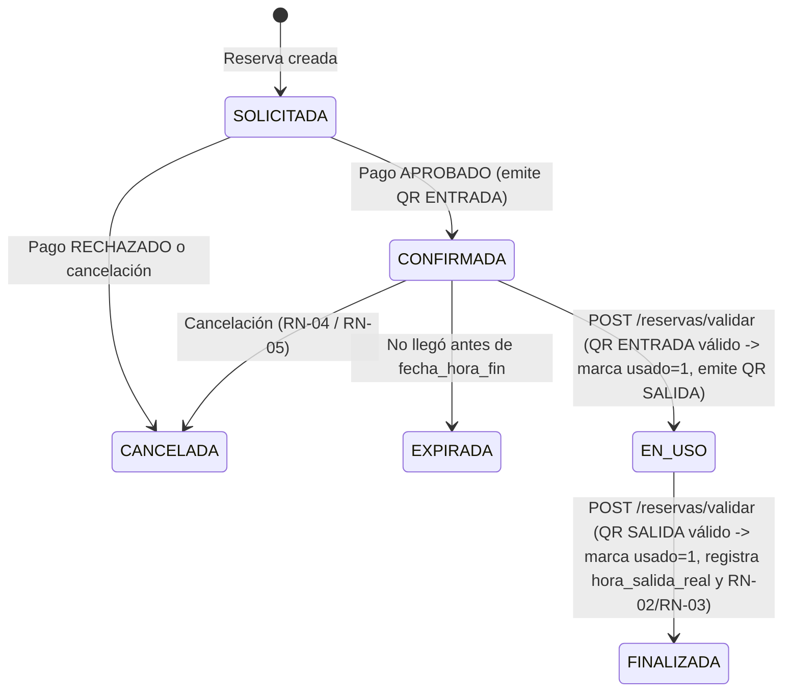

# Especificación Técnica: Módulo 04 — Generación y Validación de Códigos QR

> **Módulo:** `04-qr-acceso`  
> **Estado:** Listo para Implementación (TDD)  
> **Versión:** 1.0.0  
> **Fecha:** 2026-11-19  
> **Proyecto:** `ParkShare_Backend` (Django + Django REST Framework + MySQL)  
> **Trazabilidad MDE:** CIM (`CU-06`, `CU-08`), PIM/PSM (`CodigoQR`, `Reserva`), Reglas de Negocio (`RN-02`, `RN-03`, `RN-06`)

---

## 1. Resumen y Alcance

El **Módulo 04 (`04-qr-acceso`)** implementa el subsistema de control de acceso físico y cierre de estancia basado en códigos QR criptográficos de un solo uso para la plataforma **ParkShare**. Su propósito es garantizar que únicamente el conductor (**Arrendatario**) con una reserva pagada y vigente pueda ingresar a una cochera privada, y que el propietario (**Arrendador**) valide de forma segura tanto la llegada como la salida del vehículo.

### Alcance dentro de `ParkShare_Backend`
- Generación de tokens criptográficos únicos SHA-256 (64 caracteres hexadecimales) asociados a una reserva (`CodigoQR`).
- Emisión automática del QR de `ENTRADA` cuando el pago es aprobado y la reserva transiciona a `CONFIRMADA` (invocado desde Módulo 05) y consulta del QR activo por parte del arrendatario (`GET /reservas/{id}/qr`).
- Validación atómica y transaccional del QR escaneado por el arrendador (`POST /reservas/validar`) tanto para acceso (`ENTRADA`) como para salida (`SALIDA`).
- Transición segura de estados de la reserva (`CONFIRMADA` -> `EN_USO` -> `FINALIZADA`), registro de `hora_salida_real` y cálculo exacto de recargos por retraso fuera de tolerancia (`RN-02`, `RN-03`).
- Integración mediante capa de servicios/puentes con el Módulo 03 (`Reserva`) y Módulo 05 (`Pago` / ajuste por penalización).

### Fuera de alcance
- Renderizado visual de la imagen QR o escáner con cámara (responsabilidad exclusiva del cliente móvil React Native `ParkShareApp`).
- Procesamiento de cobro inicial o retiros bancarios (cubiertos en `specs/05-pagos-cobros/`).

---

## 2. Casos de Uso Cubiertos (CIM)

| ID | Caso de Uso | Actor Principal | Descripción del Flujo en Backend |
| :--- | :--- | :--- | :--- |
| **CU-06** | **Generar QR de acceso** | Arrendatario (disparado tras pago / consultado por el cliente) | Genera un token criptográfico SHA-256 único para la reserva únicamente cuando el pago ha sido aprobado y la reserva se encuentra en estado `CONFIRMADA`. Permite al arrendatario consultar su QR activo según el estado actual de la reserva (`ENTRADA` o `SALIDA`). |
| **CU-08** | **Validar QR de llegada** | Arrendador | El arrendador envía el token escaneado al backend. El servidor valida existencia del token, integridad de estado (`usado == 0`), vigencia temporal, estado de la reserva (`CONFIRMADA`) y propiedad de la cochera (`cochera.arrendador_id == usuario autenticado`). Si es válido, marca el QR de entrada como usado, pasa la reserva a `EN_USO`, emite el QR de `SALIDA` y retorna los datos de verificación del arrendatario y su vehículo. |
| **CU-08 (Extensión Checkout)** | **Validar QR de salida (`RN-06`)** | Arrendador | Al finalizar la estancia, el arrendatario muestra su QR de `SALIDA` y el arrendador lo escanea. El servidor valida token, propiedad y estado `EN_USO`, marca el QR de salida como usado, registra `hora_salida_real = now()`, calcula `monto_penalizacion` según `RN-02` y `RN-03`, y transiciona la reserva a `FINALIZADA`. |

---

## 3. Reglas de Negocio Aplicables (`RN-XX`)

| Regla | Aplicación Específica en el Módulo 04 |
| :--- | :--- |
| **RN-06 (QR de salida)** | Al hacer su salida, el arrendatario debe mostrar su código QR con `tipo_qr = 'SALIDA'` para confirmar el checkout. La validación exitosa registra `reserva.hora_salida_real`, marca el QR como `usado = 1` y transiciona la reserva de `EN_USO` a `FINALIZADA`. |
| **RN-02 (Tiempo de tolerancia)** | Al concluir el tiempo reservado (`reserva.fecha_hora_fin`), se otorgan exactamente **10 minutos de tolerancia** (`limite_tolerancia = reserva.fecha_hora_fin + 10 min`) para que el arrendatario retire su vehículo sin cargo adicional (`monto_penalizacion = 0.00`). |
| **RN-03 (Recargo por retraso)** | Si `hora_salida_real > limite_tolerancia`, se cobra **$10.00 MXN por cada minuto de retraso** posterior a los 10 minutos de tolerancia. Ejemplo normativo: salir 10 minutos después del fin de la tolerancia (`fecha_hora_fin + 20 min`) equivale a un cargo de `$100.00 MXN`.<br>**Fórmula determinista:**<br>- Si `hora_salida_real <= fecha_hora_fin + 10 min` -> `minutos_retraso = 0`, `recargo = Decimal("0.00")`.<br>- Si `hora_salida_real > fecha_hora_fin + 10 min` -> `segundos_exceso = (hora_salida_real - (fecha_hora_fin + 10 min)).total_seconds()`; `minutos_retraso = math.ceil(segundos_exceso / 60)`; `recargo = Decimal(minutos_retraso) * Decimal("10.00")`. (El uso de techo por minuto iniciado evita fracciones sin cobro tras vencer la tolerancia y mantiene exactitud en minutos enteros como `600 s = 10 min = $100.00 MXN`). |
| **Alineación con RN-01 / RN-04 / RN-05** | Si una reserva es cancelada (`estado = 'CANCELADA'`) o expirada (`estado = 'EXPIRADA'`), cualquier QR previamente emitido para ella queda rechazado durante la validación (`409 Conflict` / `410 Gone`). Solo reservas `CONFIRMADA` o `EN_USO` pueden operar códigos QR activos. |

### Máquina de Estados de Reserva y Códigos QR



---

## 4. Modelo de Datos (Diccionario de Datos / PSM)

### 4.1 Tabla `codigo_qr`

Modelo Django sugerido: `CodigoQR` (`Meta.db_table = 'codigo_qr'`).

| Columna | Tipo SQL (MySQL) | Tipo Django ORM | Nulidad | Default / Restricciones | Descripción |
| :--- | :--- | :--- | :--- | :--- | :--- |
| `id_qr` | `BIGINT AUTO_INCREMENT` | `models.BigAutoField(primary_key=True)` | No nulo | `PK` | Identificador único del código QR. |
| `reserva_id` | `BIGINT` | `models.ForeignKey('Reserva', db_column='reserva_id', on_delete=models.CASCADE, related_name='codigos_qr')` | No nulo | `FK -> reserva.id_reserva`, `INDEX` | Reserva a la que pertenece el código QR. |
| `token_qr` | `VARCHAR(64)` | `models.CharField(max_length=64, unique=True)` | No nulo | `UNIQUE`, formato `[0-9a-f]{64}` | Token criptográfico SHA-256 de 64 caracteres hexadecimales generado con entropía CSPRNG (`secrets.token_bytes(32)` + `hashlib.sha256`). |
| `tipo_qr` | `ENUM('ENTRADA', 'SALIDA')` | `models.CharField(max_length=10, choices=TipoQR.choices)` | No nulo | `CHECK (tipo_qr IN ('ENTRADA', 'SALIDA'))` | Fase del ciclo de uso del código QR. |
| `usado` | `TINYINT(1)` / `BOOLEAN` | `models.BooleanField(default=False)` | No nulo | Default `0` (`False`) | `0` (`False`) = Activo, `1` (`True`) = Usado. |
| `fecha_emision` | `DATETIME` | `models.DateTimeField()` | No nulo | `timezone.now` al emitirse | Fecha y hora UTC/local (aware) de generación del token. |
| `expiracion` | `DATETIME` | `models.DateTimeField()` | No nulo | `INDEX` | Fecha y hora límite de validez del token. |

#### Restricciones e Índices de Integridad (`Meta`)
1. `UNIQUE(token_qr)`: Garantiza unicidad global del token criptográfico.
2. `UNIQUE(reserva_id, tipo_qr)` (`UniqueConstraint(fields=['reserva', 'tipo_qr'], name='uq_codigo_qr_reserva_tipo')`): Garantiza como máximo un QR de `ENTRADA` y un QR de `SALIDA` por reserva, evitando duplicados ante concurrencia.
3. `CheckConstraint`: `token_qr` exactamente de 64 caracteres hexadecimales (validado en `clean()` del modelo y serializadores) y `expiracion > fecha_emision`.
4. Índice compuesto en `('reserva', 'tipo_qr', 'usado')` y en `'token_qr'` para búsquedas en `O(1)` / índice único al escanear.

### 4.2 Reglas de Vigencia (`fecha_emision` y `expiracion`)
- **QR de `ENTRADA`**:
  - Se emite únicamente cuando `reserva.estado == 'CONFIRMADA'` (y el pago fue aprobado).
  - `expiracion = reserva.fecha_hora_fin` (no puede validarse un ingreso una vez concluido el horario reservado).
  - Ventana de validación al escanear: desde `reserva.fecha_hora_inicio - timedelta(minutes=15)` hasta `expiracion` (`reserva.fecha_hora_fin`). Si el arrendatario llega más de 15 minutos antes de `fecha_hora_inicio`, se rechaza temporalmente sin consumir el QR (`usado` permanece en `0`).
- **QR de `SALIDA`**:
  - Se emite automáticamente al validar con éxito el QR de `ENTRADA` (transición `CONFIRMADA -> EN_USO`).
  - `expiracion = max(reserva.fecha_hora_fin, now) + timedelta(hours=24)`: **Decisión crítica de diseño** — la expiración técnica del QR de salida debe ser posterior a `reserva.fecha_hora_fin` para permitir que un arrendatario con retraso (`RN-03`) pueda escanear su QR de salida, registrar `hora_salida_real` y recibir el cálculo de recargo en lugar de quedar bloqueado por token expirado.

### 4.3 Dependencias con Tablas Externas (Módulos 01, 02, 03 y 05)
El Módulo 04 consulta y actualiza de forma controlada los siguientes campos definidos en módulos previos/adyacentes:
- **`reserva`** (`03-reservas`): `id_reserva`, `arrendatario_id`, `cochera_id`, `estado` (`SOLICITADA`, `CONFIRMADA`, `EN_USO`, `FINALIZADA`, `CANCELADA`, `EXPIRADA`), `fecha_hora_inicio`, `fecha_hora_fin`, `hora_salida_real`, `monto_base`, `monto_penalizacion`. Delega las transiciones de estado en los servicios `start_reservation_usage` y `finish_reservation` de `03-reservas`.
- **`cochera`** (`02-cocheras`): `id_cochera`, `arrendador_id`, `nombre`, `direccion`.
- **`usuario`** (`01-auth`): `id_usuario`, `nombre_completo`, `rol`, `estado_cuenta` (`'ACTIVA'`), `placas`, `modelo_vehiculo`.
- **Módulo 05 (`Pago`)**: Al emitir el QR de `ENTRADA` se verifica que la reserva esté `CONFIRMADA`; al calcular recargo por retraso en `SALIDA` (`monto_penalizacion > 0`), se invoca al servicio de ajuste de cobro del Módulo 05 para reflejar el total cobrado (`monto_base + monto_penalizacion`).

---

## 5. Contratos de API REST (Endpoints)

> **Convención de rutas:** Las rutas indicadas corresponden a la definición funcional del backend (`ParkShare_Backend/urls.py`). Todas requieren autenticación mediante token/sesión JWT/DRF en cabecera `Authorization: Bearer <token>` y respuestas en JSON (`Content-Type: application/json`). Los mensajes dirigidos al usuario se retornan en **español**.

### 5.1 `GET /reservas/{id}/qr`

Devuelve el código QR activo correspondiente al estado actual de la reserva (`ENTRADA` si la reserva está `CONFIRMADA`; `SALIDA` si está `EN_USO`).

- **Autenticación:** Requerida.
- **Permisos / Rol:** Usuario autenticado con rol `ARRENDATARIO` y propietario de la reserva (`reserva.arrendatario_id == request.user.id_usuario`).
- **Parámetros de ruta:**
  - `id` (`integer`): Identificador de la reserva (`reserva.id_reserva`).
- **Parámetros de consulta (Query Params):** Ninguno.
- **Cuerpo de petición:** No aplica.

#### Respuestas Esperadas

- **`200 OK`** — Reserva en estado `CONFIRMADA` (devuelve QR de `ENTRADA`) o `EN_USO` (devuelve QR de `SALIDA`):

```json
{
  "id_qr": 42,
  "reserva_id": 105,
  "token_qr": "9f86d081884c7d659a2feaa0c55ad015a3bf4f1b2b0b822cd15d6c15b0f00a08",
  "tipo_qr": "ENTRADA",
  "usado": false,
  "fecha_emision": "2026-11-19T14:05:00-06:00",
  "expiracion": "2026-11-19T18:00:00-06:00",
  "reserva": {
    "id_reserva": 105,
    "estado": "CONFIRMADA",
    "fecha_hora_inicio": "2026-11-19T16:00:00-06:00",
    "fecha_hora_fin": "2026-11-19T18:00:00-06:00"
  }
}
```

- **`401 Unauthorized`** — Sin credenciales válidas.
- **`403 Forbidden`** — El usuario no es `ARRENDATARIO` o intenta consultar el QR de una reserva ajena:

```json
{
  "error": "Forbidden",
  "detail": "No tienes permiso para consultar el código QR de esta reserva."
}
```

- **`404 Not Found`** — No existe la reserva `{id}`:

```json
{
  "error": "NotFound",
  "detail": "La reserva solicitada no existe."
}
```

- **`409 Conflict`** — La reserva está en `SOLICITADA` (pago pendiente), `CANCELADA`, `EXPIRADA` o `FINALIZADA`, o no existe un QR activo para el estado:

```json
{
  "error": "InvalidReservationState",
  "detail": "La reserva no cuenta con un código QR activo en su estado actual (SOLICITADA)."
}
```

---

### 5.2 `POST /reservas/validar`

Valida un token QR escaneado por el arrendador para autorizar la entrada (`CONFIRMADA -> EN_USO`) o confirmar la salida (`EN_USO -> FINALIZADA`).

- **Autenticación:** Requerida.
- **Permisos / Rol:** Usuario autenticado con rol `ARRENDADOR` (cuenta activa y verificada según `RN-08`), dueño de la cochera asociada a la reserva del QR.
- **Cuerpo de petición (Request Payload JSON):**

```json
{
  "token": "9f86d081884c7d659a2feaa0c55ad015a3bf4f1b2b0b822cd15d6c15b0f00a08"
}
```

#### Reglas de Validación de Entrada
- `token`: Obligatorio, cadena de 64 caracteres hexadecimales (`^[0-9a-fA-F]{64}$`). Se normaliza a minúsculas antes de buscar.

#### Respuestas Esperadas

- **`200 OK` (Caso `tipo_qr == 'ENTRADA'`)** — Marca `usado = true`, pasa reserva a `'EN_USO'` y emite el QR de `'SALIDA'` (por seguridad, el endpoint devuelve `qr_salida_emitido: true` **sin exponer el `token_qr` de salida al arrendador**, pues dicho token pertenece al arrendatario para presentarlo al salir conforme a `RN-06`):

```json
{
  "mensaje": "Entrada autorizada. La reserva ahora se encuentra en uso.",
  "tipo_qr": "ENTRADA",
  "estado_reserva": "EN_USO",
  "qr_salida_emitido": true,
  "verificacion": {
    "reserva_id": 105,
    "fecha_hora_inicio": "2026-11-19T16:00:00-06:00",
    "fecha_hora_fin": "2026-11-19T18:00:00-06:00",
    "arrendatario": {
      "id_usuario": 14,
      "nombre_completo": "Carlos Mendoza Ruiz",
      "placas": "ABC-123-D",
      "modelo_vehiculo": "Volkswagen Jetta 2020"
    }
  }
}
```

- **`200 OK` (Caso `tipo_qr == 'SALIDA'`)** — Marca `usado = true`, registra `hora_salida_real = now()`, aplica `RN-02` (10 min de tolerancia) y `RN-03` ($10.00 MXN/min adicional) y pasa la reserva a `'FINALIZADA'`:

```json
{
  "mensaje": "Salida confirmada. Reserva finalizada con recargo por retraso.",
  "tipo_qr": "SALIDA",
  "estado_reserva": "FINALIZADA",
  "verificacion": {
    "reserva_id": 105,
    "fecha_hora_inicio": "2026-11-19T16:00:00-06:00",
    "fecha_hora_fin": "2026-11-19T18:00:00-06:00",
    "hora_salida_real": "2026-11-19T18:20:00-06:00",
    "tolerancia_minutos": 10,
    "minutos_retraso": 10,
    "monto_base": "80.00",
    "monto_penalizacion": "100.00",
    "monto_total": "180.00",
    "arrendatario": {
      "id_usuario": 14,
      "nombre_completo": "Carlos Mendoza Ruiz",
      "placas": "ABC-123-D",
      "modelo_vehiculo": "Volkswagen Jetta 2020"
    }
  }
}
```

- **`400 Bad Request`** — Campo `token` ausente, vacío o no cumple formato SHA-256 (64 caracteres hexadecimales):

```json
{
  "error": "ValidationError",
  "detail": "El token QR debe ser una cadena hexadecimal válida de 64 caracteres."
}
```

- **`401 Unauthorized`** — Usuario no autenticado.
- **`403 Forbidden`** — Usuario no es `ARRENDADOR`, su cuenta está inactiva/pendiente (`RN-08`), o la cochera de la reserva no pertenece al arrendador autenticado:

```json
{
  "error": "Forbidden",
  "detail": "No tienes permiso para validar códigos QR de una cochera que no te pertenece."
}
```

- **`404 Not Found`** — El token QR no existe en la base de datos:

```json
{
  "error": "NotFound",
  "detail": "Código QR no encontrado o inválido."
}
```

- **`409 Conflict`** — El código QR ya fue utilizado (`usado == 1`), la reserva fue cancelada/expirada o no coincide con el estado esperado (`ENTRADA` requiere `CONFIRMADA`; `SALIDA` requiere `EN_USO`), o aún es demasiado pronto para el ingreso (`now < fecha_hora_inicio - 15 min`):

```json
{
  "error": "QRAlreadyUsed",
  "detail": "Este código QR ya fue utilizado previamente."
}
```

- **`410 Gone`** — El código QR está vigente en estado (`usado == 0`) pero superó su `expiracion` (`now > expiracion`):

```json
{
  "error": "QRExpired",
  "detail": "El código QR ha expirado y ya no es válido."
}
```

---

## 6. Escenarios de Prueba para TDD

### 6.1 Casos Felices (Happy Path)
1. **Generación automática de token SHA-256 (`CU-06`)**: Al confirmar pago de una reserva (`SOLICITADA -> CONFIRMADA`), se crea un `CodigoQR` con `tipo_qr='ENTRADA'`, `usado=False`, `len(token_qr) == 64`, solo caracteres hexadecimales y `expiracion == reserva.fecha_hora_fin`.
2. **Consulta de QR por el arrendatario (`GET /reservas/{id}/qr`)**:
   - En estado `CONFIRMADA`, retorna `200 OK` con el QR `ENTRADA`.
   - En estado `EN_USO`, retorna `200 OK` con el QR `SALIDA`.
3. **Validación de llegada (`CU-08`, `POST /reservas/validar` con `ENTRADA`)**: Arrendador dueño de la cochera escanea el token de `ENTRADA` dentro de la ventana vigente -> retorna `200 OK`, `codigo_qr_entrada.usado == True`, `reserva.estado == 'EN_USO'`, se crea `CodigoQR` de `SALIDA` (`usado=False`) y la respuesta incluye `nombre_completo`, `placas`, `modelo_vehiculo` y horario reservado (sin filtrar el `token_qr` de salida al arrendador).
4. **Validación de salida a tiempo (`RN-06`, `RN-02`)**: Arrendador escanea QR de `SALIDA` antes de `fecha_hora_fin` -> `200 OK`, `reserva.estado == 'FINALIZADA'`, `hora_salida_real` registrada, `minutos_retraso == 0`, `monto_penalizacion == Decimal('0.00')`.
5. **Validación de salida dentro de tolerancia (`RN-02`)**: Arrendador escanea QR de `SALIDA` exactamente a `fecha_hora_fin + 10 minutos` (y a `fecha_hora_fin + 9 min 59 s`) -> `200 OK`, `minutos_retraso == 0`, `monto_penalizacion == Decimal('0.00')`.
6. **Validación de salida con retraso (`RN-03`)**:
   - Salida a `fecha_hora_fin + 11 minutos` (1 minuto fuera de tolerancia) -> `minutos_retraso == 1`, `monto_penalizacion == Decimal('10.00')`.
   - Salida a `fecha_hora_fin + 20 minutos` (10 minutos fuera de tolerancia, caso ejemplo de la Constitución) -> `minutos_retraso == 10`, `monto_penalizacion == Decimal('100.00')`.

### 6.2 Casos de Error y Validación
1. **Token malformado en `POST /reservas/validar`**: Token vacío, nulo, menor a 64 caracteres o con caracteres no hexadecimales (`"xyz"`) -> `400 Bad Request`.
2. **Token inexistente**: Token SHA-256 válido en formato pero inexistente en BD -> `404 Not Found`.
3. **Acceso sin autenticación**: Peticiones a `GET /reservas/{id}/qr` o `POST /reservas/validar` sin token -> `401 Unauthorized`.
4. **Autorización cruzada en `GET /reservas/{id}/qr`**: Otro `ARRENDATARIO` o un `ARRENDADOR` intenta obtener el QR de una reserva ajena -> `403 Forbidden`.
5. **Autorización cruzada en `POST /reservas/validar`**: Un `ARRENDADOR` intenta escanear el QR de una cochera que pertenece a otro arrendador, o un `ARRENDATARIO` intenta llamar a `/reservas/validar` -> `403 Forbidden`.
6. **Arrendador no verificado (`RN-08`)**: Arrendador con cuenta pendiente o inactiva (`estado_cuenta != 'ACTIVA'`) intenta validar QR -> `403 Forbidden`.
7. **Consulta de QR en reserva no confirmada / finalizada / cancelada / expirada**: `GET /reservas/{id}/qr` con reserva en `SOLICITADA`, `CANCELADA`, `EXPIRADA` o `FINALIZADA` -> `409 Conflict`.
8. **Reuso de QR ya consumido**: Reenviar el mismo `token` de `ENTRADA` o `SALIDA` que ya tiene `usado == True` -> `409 Conflict` sin alterar el estado de la reserva.
9. **QR expirado**: Escanear QR de `ENTRADA` cuando `now > reserva.fecha_hora_fin` -> `410 Gone`, `usado` se mantiene en `False` y la reserva no pasa a `EN_USO`.
10. **Reserva cancelada**: Intentar validar QR de `ENTRADA` cuya reserva pasó a `CANCELADA` -> `409 Conflict`.

### 6.3 Casos Límite (Edge Cases)
1. **Concurrencia en escaneo simultáneo**: Dos peticiones concurrentes a `POST /reservas/validar` con el mismo token usando `select_for_update()` -> exactamente una obtiene `200 OK` y la otra `409 Conflict`, sin duplicar la emisión del QR de `SALIDA` ni recalcular dos veces la salida.
2. **Frontera exacta de tolerancia (`RN-02`)**:
   - `fecha_hora_fin + 10 min 00 s` -> `$0.00 MXN`.
   - `fecha_hora_fin + 10 min 01 s` -> `1 min` cobrable (`$10.00 MXN`).
3. **Salida muy tardía (ej. +3 horas sobre `fecha_hora_fin`)**: El QR de `SALIDA` no debe marcarse expirado a las `fecha_hora_fin`, permitiendo finalizar la estancia y cobrar `170 * $10.00 = $1,700.00 MXN` sin quedar bloqueado.
4. **Llegada anticipada dentro y fuera de ventana**:
   - Llegada `10 min` antes de `fecha_hora_inicio` -> `200 OK` (dentro de ventana de cortesía de 15 min).
   - Llegada `2 horas` antes de `fecha_hora_inicio` -> `409 Conflict` (demasiado temprano; `usado` sigue en `False`).
5. **Integridad de unicidad en BD**: Intentar insertar directamente un segundo `CodigoQR` con el mismo `(reserva_id, tipo_qr)` o el mismo `token_qr` debe lanzar `IntegrityError`.
