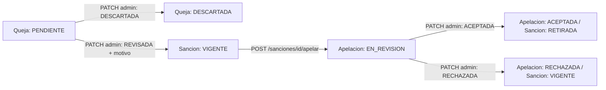

# Especificación Técnica: Módulo 06 — Reseñas, Quejas, Sanciones y Apelaciones

> **Módulo:** `06-quejas-sanciones-resenas`  
> **Estado:** Listo para Implementación (TDD)  
> **Versión:** 1.0.0  
> **Fecha:** 2026-11-19  
> **Proyecto:** `ParkShare_Backend` (Django + Django REST Framework + MySQL)  
> **Trazabilidad MDE:** CIM (`CU-09`, `CU-12`, `CU-13`), PIM/PSM (`Resena`, `Queja`, `Sancion`, `Apelacion`)

---

## 1. Resumen y Alcance

El **Módulo 06 (`06-quejas-sanciones-resenas`)** proporciona los mecanismos de reputación bilateral, reporte de incidencias, disciplina administrativa y derecho de apelación en **ParkShare_Backend**. Su finalidad es fomentar la confianza entre conductores (**Arrendatarios**) y propietarios (**Arrendadores**) bajo la supervisión del **Administrador**.

### Alcance dentro de `ParkShare_Backend`
- **Reseñas mutuas (`CU-09`)**: Registro de calificaciones (1 a 5 estrellas), etiquetas rápidas y comentarios opcionales una vez finalizada una reserva (`estado = 'FINALIZADA'`), garantizando como máximo una reseña por participante (máximo 2 por reserva).
- **Quejas de arrendatarios (`CU-12`)**: Creación de reportes formales de incidentes asociados a reservas en estado `CONFIRMADA`, `EN_USO` o `FINALIZADA`.
- **Gestión administrativa de quejas y sanciones (`CU-13`)**: Bandeja de administración para listar quejas pendientes y apelaciones en revisión, inspeccionar el detalle de cada queja y resolver descartándola (`DESCARTADA`) o sancionando al arrendador (`REVISADA` + creación de `Sancion` `VIGENTE`).
- **Consulta y apelación de sanciones (`CU-13`)**: Visibilidad para el arrendador de su historial de sanciones (`VIGENTE` y `RETIRADA`), presentación de apelaciones con explicación y evidencia (`url_evidencia`), y resolución final por parte del administrador (`ACEPTADA` -> retira sanción; `RECHAZADA` -> mantiene sanción vigente).
- **Puntos de integración con módulos previos**:
  - **Módulo `01-auth` (`GET /admin/cuentas/{id}`)**: Alimenta `resumen_disciplinario`, `historial_quejas` e `historial_sanciones` a partir de las tablas `queja` y `sancion`.
  - **Módulo `02-cocheras` (`GET /cocheras/{id}`)**: Alimenta `calificacion_promedio` y `total_resenas` agregando las reseñas emitidas sobre reservas de dicha cochera (`autor_id == reserva.arrendatario_id`).

> **Nota técnica de enrutamiento (`ParkShare_Backend/urls.py`)**: Al igual que en `01-auth` y `02-cocheras`, los endpoints `/admin/quejas` y `/admin/apelaciones/{id}` deberán respetar el prefijo API definido globalmente (ej. `/api/v1/admin/quejas` o reubicación del admin nativo de Django) para evitar colisión con `path('admin/', admin.site.urls)`.

### Fuera de alcance
- Suspensión permanente de cuentas (`CU-11`, tabla `suspension_cuenta`), cubierta en el módulo de administración/usuarios.
- Carga binaria directa hacia almacenamiento externo S3/Cloudinary (este módulo recibe y valida `url_evidencia` como cadena URL/ruta tras la carga).

---

## 2. Casos de Uso Cubiertos (CIM)

| ID | Caso de Uso | Actor Principal | Descripción del Flujo en Backend |
| :--- | :--- | :--- | :--- |
| **CU-09** | **Calificar y reseñar** | Arrendatario y Arrendador | Al finalizar una reserva (`FINALIZADA`), cualquiera de los dos participantes puede emitir una reseña dirigida a la contraparte con puntuación `1..5`, etiquetas y comentario opcional. El backend deriva automáticamente `autor_id` y `destinatario_id` y bloquea duplicados. |
| **CU-12** | **Enviar queja** | Arrendatario | El arrendatario reporta un incidente sobre una reserva válida (`CONFIRMADA`, `EN_USO` o `FINALIZADA`) seleccionando una categoría predefinida (`motivo_categoria`) y detallando los hechos (`descripcion`). La queja queda en estado `PENDIENTE`. |
| **CU-13** | **Sancionar Arrendador y Resolver Apelaciones** | Administrador (resuelve) / Arrendador (consulta y apela) | El administrador consulta quejas `PENDIENTE`s y apelaciones `EN_REVISION`, resuelve cada queja (`DESCARTADA` o `REVISADA` generando una `Sancion` `VIGENTE`), y ante una apelación presentada por el arrendador decide aceptarla (`ACEPTADA` -> sanción `RETIRADA`) o rechazarla (`RECHAZADA` -> sanción continúa `VIGENTE`). |

---

## 3. Reglas de Negocio Aplicables (`RN-XX`) y Reglas de Integridad del Módulo

Aunque las reglas `RN-01` a `RN-10` se centran en reservas, tarifas, QR y altas iniciales, el Módulo 06 interactúa directamente con el ciclo de vida resultante de dichas reglas y establece las siguientes restricciones operativas obligatorias:

1. **Dependencia de cierre (`RN-06`) para reseñas (`CU-09`)**:
   - Solo pueden crearse reseñas cuando la reserva alcanzó el estado `'FINALIZADA'` (tras validarse la salida o completarse la estancia).
   - Máximo **2 reseñas por reserva**: exactamente una del arrendatario hacia el arrendador (`autor_id = reserva.arrendatario_id`, `destinatario_id = cochera.arrendador_id`) y una del arrendador hacia el arrendatario (`autor_id = cochera.arrendador_id`, `destinatario_id = reserva.arrendatario_id`). Se prohíbe la autoevaluación (`autor_id != destinatario_id`).
2. **Ventana de estados válidos para quejas (`CU-12`)**:
   - Solo el **Arrendatario** titular de la reserva puede levantar una queja sobre ella, y únicamente si `reserva.estado` es `'CONFIRMADA'`, `'EN_USO'` o `'FINALIZADA'`. Reservas en estado `'SOLICITADA'`, `'CANCELADA'` o `'EXPIRADA'` no admiten quejas mediante `POST /quejas`.
3. **Flujo disciplinario y no re-resolución (`CU-13`)**:
   - Una queja en estado `'PENDIENTE'` solo puede resolverse una vez (`PENDIENTE -> DESCARTADA` o `PENDIENTE -> REVISADA`). Cuando pasa a `'REVISADA'`, debe crearse atómicamente un registro en `sancion` con `estado = 'VIGENTE'`.
   - La cuenta de `arrendador` y `admin` referenciadas en `sancion` quedan registradas para trazabilidad de auditoría (`CU-11` podrá consultar cuántas sanciones `VIGENTE`s acumula el arrendador).
4. **Reglas de apelación (`CU-13`)**:
   - Solo el arrendador afectado puede apelar su sanción y únicamente mientras `sancion.estado == 'VIGENTE'`.
   - Cada sanción admite como máximo una apelación (`UNIQUE(sancion_id)`), evitando envíos repetidos sobre la misma sanción.
   - La resolución de apelación es terminal (`EN_REVISION -> ACEPTADA` o `EN_REVISION -> RECHAZADA`):
     - `ACEPTADA`: actualiza `apelacion.estado = 'ACEPTADA'` y `sancion.estado = 'RETIRADA'` en una misma transacción atómica.
     - `RECHAZADA`: actualiza `apelacion.estado = 'RECHAZADA'` y mantiene `sancion.estado = 'VIGENTE'`.

### Flujo de Estados de Quejas, Sanciones y Apelaciones



---

## 4. Modelo de Datos (Diccionario de Datos / PSM)

### 4.1 Tabla `resena`

Modelo Django sugerido: `Resena` (`Meta.db_table = 'resena'`).

| Columna | Tipo SQL (MySQL) | Tipo Django ORM | Nulidad | Default / Restricciones | Descripción |
| :--- | :--- | :--- | :--- | :--- | :--- |
| `id_resena` | `BIGINT AUTO_INCREMENT` | `models.BigAutoField(primary_key=True)` | No nulo | `PK` | Identificador único de la reseña. |
| `reserva_id` | `BIGINT` | `models.ForeignKey('Reserva', db_column='reserva_id', on_delete=models.CASCADE, related_name='resenas')` | No nulo | `FK -> reserva.id_reserva` | Reserva evaluada. |
| `autor_id` | `BIGINT` | `models.ForeignKey('Usuario', db_column='autor_id', on_delete=models.PROTECT, related_name='resenas_emitidas')` | No nulo | `FK -> usuario.id_usuario` | Participante que emite la reseña. |
| `destinatario_id` | `BIGINT` | `models.ForeignKey('Usuario', db_column='destinatario_id', on_delete=models.PROTECT, related_name='resenas_recibidas')` | No nulo | `FK -> usuario.id_usuario`, `INDEX` | Participante evaluado. |
| `calificacion` | `INT` | `models.PositiveSmallIntegerField()` | No nulo | `CHECK (calificacion >= 1 AND calificacion <= 5)` | Puntuación numérica entera entre `1` y `5`. |
| `etiquetas` | `VARCHAR(255)` | `models.CharField(max_length=255, null=True, blank=True)` | Sí nulo | — | Etiquetas separadas por coma (ej. `'Puntual,Respetó el espacio,Buen trato'`). |
| `comentario` | `TEXT` | `models.TextField(null=True, blank=True)` | Sí nulo | — | Comentario textual opcional del autor. |
| `fecha` | `DATETIME` | `models.DateTimeField()` | No nulo | `timezone.now` | Fecha y hora de creación de la reseña. |

- **Restricciones obligatorias (`Meta`)**:
  - `UniqueConstraint(fields=['reserva', 'autor'], name='uq_resena_reserva_autor')` -> garantiza `UNIQUE(reserva_id, autor_id)` (máximo 1 reseña por parte, 2 en total por reserva).
  - `CheckConstraint` de rango `calificacion__gte=1` y `calificacion__lte=5`.
  - `CheckConstraint` `~Q(autor=F('destinatario'))` para impedir autocalificación.

---

### 4.2 Tabla `queja`

Modelo Django sugerido: `Queja` (`Meta.db_table = 'queja'`).

| Columna | Tipo SQL (MySQL) | Tipo Django ORM | Nulidad | Default / Restricciones | Descripción |
| :--- | :--- | :--- | :--- | :--- | :--- |
| `id_queja` | `BIGINT AUTO_INCREMENT` | `models.BigAutoField(primary_key=True)` | No nulo | `PK` | Identificador único de la queja. |
| `reserva_id` | `BIGINT` | `models.ForeignKey('Reserva', db_column='reserva_id', on_delete=models.PROTECT, related_name='quejas')` | No nulo | `FK -> reserva.id_reserva`, `INDEX` | Reserva sobre la que se presenta la queja. |
| `arrendatario_id` | `BIGINT` | `models.ForeignKey('Usuario', db_column='arrendatario_id', on_delete=models.PROTECT, related_name='quejas_enviadas')` | No nulo | `FK -> usuario.id_usuario` | Arrendatario denunciante. |
| `arrendador_id` | `BIGINT` | `models.ForeignKey('Usuario', db_column='arrendador_id', on_delete=models.PROTECT, related_name='quejas_recibidas')` | No nulo | `FK -> usuario.id_usuario`, `INDEX` | Arrendador reportado. |
| `motivo_categoria` | `ENUM('TRATO_INADECUADO', 'NO_PUDE_ACCEDER', 'DISTINTA_A_PUBLICADO', 'OTRO')` | `models.CharField(max_length=30, choices=MotivoCategoria.choices)` | No nulo | `CHECK` de valores enum | Categoría normalizada del incidente. |
| `descripcion` | `TEXT` | `models.TextField()` | No nulo | No vacío en validación | Relato detallado del incidente. |
| `estado` | `ENUM('PENDIENTE', 'REVISADA', 'DESCARTADA')` | `models.CharField(max_length=15, choices=EstadoQueja.choices, default='PENDIENTE')` | No nulo | Default `'PENDIENTE'`, `INDEX` | Estado de atención por administración. |
| `fecha_creacion` | `DATETIME` | `models.DateTimeField()` | No nulo | `timezone.now` | Fecha y hora de registro de la queja. |

---

### 4.3 Tabla `sancion`

Modelo Django sugerido: `Sancion` (`Meta.db_table = 'sancion'`).

| Columna | Tipo SQL (MySQL) | Tipo Django ORM | Nulidad | Default / Restricciones | Descripción |
| :--- | :--- | :--- | :--- | :--- | :--- |
| `id_sancion` | `BIGINT AUTO_INCREMENT` | `models.BigAutoField(primary_key=True)` | No nulo | `PK` | Identificador único de la sanción. |
| `queja_id` | `BIGINT` | `models.OneToOneField('Queja', db_column='queja_id', on_delete=models.PROTECT, related_name='sancion')` | No nulo | `FK -> queja.id_queja`, `UNIQUE` | Queja origen de la sanción (como máximo 1 sanción por queja). |
| `arrendador_id` | `BIGINT` | `models.ForeignKey('Usuario', db_column='arrendador_id', on_delete=models.PROTECT, related_name='sanciones')` | No nulo | `FK -> usuario.id_usuario`, `INDEX` | Arrendador sancionado. |
| `admin_id` | `BIGINT` | `models.ForeignKey('Usuario', db_column='admin_id', on_delete=models.PROTECT, related_name='sanciones_emitidas')` | No nulo | `FK -> usuario.id_usuario` | Administrador que impuso la sanción. |
| `motivo` | `TEXT` | `models.TextField()` | No nulo | No vacío en validación | Justificación administrativa de la sanción. |
| `estado` | `ENUM('VIGENTE', 'RETIRADA')` | `models.CharField(max_length=15, choices=EstadoSancion.choices, default='VIGENTE')` | No nulo | Default `'VIGENTE'`, `INDEX` | Vigencia actual de la sanción. |
| `fecha_creacion` | `DATETIME` | `models.DateTimeField()` | No nulo | `timezone.now` | Fecha y hora de imposición de la sanción. |

---

### 4.4 Tabla `apelacion`

Modelo Django sugerido: `Apelacion` (`Meta.db_table = 'apelacion'`).

| Columna | Tipo SQL (MySQL) | Tipo Django ORM | Nulidad | Default / Restricciones | Descripción |
| :--- | :--- | :--- | :--- | :--- | :--- |
| `id_apelacion` | `BIGINT AUTO_INCREMENT` | `models.BigAutoField(primary_key=True)` | No nulo | `PK` | Identificador único de la apelación. |
| `sancion_id` | `BIGINT` | `models.OneToOneField('Sancion', db_column='sancion_id', on_delete=models.PROTECT, related_name='apelacion')` | No nulo | `FK -> sancion.id_sancion`, `UNIQUE` | Sanción apelada (1 apelación por sanción). |
| `descripcion` | `TEXT` | `models.TextField()` | No nulo | No vacío en validación | Explicación y argumentos del arrendador. |
| `url_evidencia` | `VARCHAR(255)` | `models.CharField(max_length=255, null=True, blank=True)` | Sí nulo | Validación URL/ruta si se provee | URL de foto o captura de evidencia adjunta. |
| `estado` | `ENUM('EN_REVISION', 'ACEPTADA', 'RECHAZADA')` | `models.CharField(max_length=15, choices=EstadoApelacion.choices, default='EN_REVISION')` | No nulo | Default `'EN_REVISION'`, `INDEX` | Estado de revisión de la apelación. |
| `fecha_creacion` | `DATETIME` | `models.DateTimeField()` | No nulo | `timezone.now` | Fecha y hora de envío de la apelación. |

---

## 5. Contratos de API REST (Endpoints)

### 5.1 `POST /reservas/{id}/resenas`

Crea una reseña de evaluación mutua sobre una reserva finalizada.

- **Autenticación:** Requerida.
- **Permisos / Rol:** Usuario participante de la reserva (`ARRENDATARIO` dueño de la reserva o `ARRENDADOR` dueño de la cochera reservada).
- **Parámetros de ruta:** `id` (`integer`, `reserva.id_reserva`).
- **Cuerpo de petición (Request Payload JSON):**

```json
{
  "calificacion": 5,
  "etiquetas": "Puntual,Respetó el espacio,Buen trato",
  "comentario": "Excelente comunicación y entrega puntual del espacio."
}
```

#### Validaciones de Entrada
- `calificacion`: Entero obligatorio (`1` a `5`, no booleano).
- `etiquetas`: Cadena opcional/nula, longitud máx. 255 chars.
- `comentario`: Cadena opcional/nula.
- `autor_id` y `destinatario_id` **se ignoran si vienen en el payload** y se asignan estrictamente desde `request.user` y la contraparte de `reserva`.

#### Respuestas Esperadas
- **`201 Created`**:

```json
{
  "id_resena": 31,
  "reserva_id": 105,
  "autor_id": 14,
  "destinatario_id": 7,
  "calificacion": 5,
  "etiquetas": "Puntual,Respetó el espacio,Buen trato",
  "comentario": "Excelente comunicación y entrega puntual del espacio.",
  "fecha": "2026-11-19T18:45:00-06:00"
}
```

- **`400 Bad Request`** — `calificacion` fuera de `1..5` o tipo inválido, o `etiquetas` > 255 chars.
- **`401 Unauthorized`** — No autenticado.
- **`403 Forbidden`** — Usuario no es ni el arrendatario ni el arrendador de la reserva (incluye `ADMIN` o terceros).
- **`404 Not Found`** — Reserva `{id}` inexistente.
- **`409 Conflict`** — La reserva no está en estado `'FINALIZADA'`, o el usuario autenticado ya emitió su reseña para esa reserva.

---

### 5.2 `POST /quejas`

Registra una queja del arrendatario sobre su reserva.

- **Autenticación:** Requerida.
- **Permisos / Rol:** `ARRENDATARIO` titular de la reserva (`reserva.arrendatario_id == request.user.id_usuario`).
- **Cuerpo de petición (Request Payload JSON):**

```json
{
  "reserva_id": 105,
  "motivo_categoria": "NO_PUDE_ACCEDER",
  "descripcion": "Llegué a las 16:05 y el portón permaneció cerrado durante 25 minutos sin respuesta del arrendador."
}
```

#### Validaciones de Entrada
- `reserva_id`: Entero obligatorio existente.
- `motivo_categoria`: Obligatorio, uno de `'TRATO_INADECUADO'`, `'NO_PUDE_ACCEDER'`, `'DISTINTA_A_PUBLICADO'`, `'OTRO'`.
- `descripcion`: Obligatorio, cadena no vacía tras `strip()`, mínimo 10 caracteres.

#### Respuestas Esperadas
- **`201 Created`**:

```json
{
  "id_queja": 18,
  "reserva_id": 105,
  "arrendatario_id": 14,
  "arrendador_id": 7,
  "motivo_categoria": "NO_PUDE_ACCEDER",
  "descripcion": "Llegué a las 16:05 y el portón permaneció cerrado durante 25 minutos sin respuesta del arrendador.",
  "estado": "PENDIENTE",
  "fecha_creacion": "2026-11-19T16:35:00-06:00"
}
```

- **`400 Bad Request`** — Categoría inválida o descripción vacía/menor a 10 caracteres.
- **`401 Unauthorized`** — No autenticado.
- **`403 Forbidden`** — Usuario no es `ARRENDATARIO` o la reserva no le pertenece.
- **`404 Not Found`** — La reserva `reserva_id` no existe.
- **`409 Conflict`** — La reserva está en estado `'SOLICITADA'`, `'CANCELADA'` o `'EXPIRADA'` (solo admite `CONFIRMADA`, `EN_USO` o `FINALIZADA`).

---

### 5.3 `GET /admin/quejas`

Lista quejas pendientes y apelaciones en revisión para el panel administrativo.

- **Autenticación:** Requerida.
- **Permisos / Rol:** `ADMIN` únicamente.
- **Parámetros de consulta opcionales (Query Params):**
  - `estado_queja`: `PENDIENTE` (default) | `REVISADA` | `DESCARTADA` | `TODAS`.
  - `estado_apelacion`: `EN_REVISION` (default) | `ACEPTADA` | `RECHAZADA` | `TODAS`.
- **Cuerpo de petición:** No aplica.

#### Respuestas Esperadas
- **`200 OK`**:

```json
{
  "quejas_pendientes": [
    {
      "id_queja": 18,
      "reserva_id": 105,
      "motivo_categoria": "NO_PUDE_ACCEDER",
      "estado": "PENDIENTE",
      "arrendatario": {
        "id_usuario": 14,
        "nombre_completo": "Carlos Mendoza Ruiz"
      },
      "arrendador": {
        "id_usuario": 7,
        "nombre_completo": "María Elena Flores"
      },
      "fecha_creacion": "2026-11-19T16:35:00-06:00"
    }
  ],
  "apelaciones_en_revision": [
    {
      "id_apelacion": 5,
      "sancion_id": 9,
      "arrendador": {
        "id_usuario": 7,
        "nombre_completo": "María Elena Flores"
      },
      "motivo_sancion": "Incumplimiento de acceso puntual al arrendatario.",
      "descripcion": "Se fue la energía eléctrica de la colonia y el portón automático quedó bloqueado 15 min.",
      "url_evidencia": "https://cdn.parkshare.mx/evidencias/reporte_cfe.jpg",
      "estado": "EN_REVISION",
      "fecha_creacion": "2026-11-19T19:10:00-06:00"
    }
  ],
  "totales": {
    "quejas": 1,
    "apelaciones": 1
  }
}
```

- **`401 Unauthorized`** — No autenticado.
- **`403 Forbidden`** — Usuario no tiene rol `ADMIN`.

---

### 5.4 `GET /admin/quejas/{id}`

Obtiene el detalle completo de una queja para evaluación del administrador.

- **Autenticación:** Requerida.
- **Permisos / Rol:** `ADMIN` únicamente.
- **Parámetros de ruta:** `id` (`integer`, `queja.id_queja`).

#### Respuestas Esperadas
- **`200 OK`**:

```json
{
  "id_queja": 18,
  "motivo_categoria": "NO_PUDE_ACCEDER",
  "descripcion": "Llegué a las 16:05 y el portón permaneció cerrado durante 25 minutos sin respuesta del arrendador.",
  "estado": "PENDIENTE",
  "fecha_creacion": "2026-11-19T16:35:00-06:00",
  "reserva": {
    "id_reserva": 105,
    "estado": "CONFIRMADA",
    "fecha_hora_inicio": "2026-11-19T16:00:00-06:00",
    "fecha_hora_fin": "2026-11-19T18:00:00-06:00",
    "cochera": "Cochera Centro Norte"
  },
  "arrendatario": {
    "id_usuario": 14,
    "nombre_completo": "Carlos Mendoza Ruiz",
    "correo": "arrendatario@parkshare.com"
  },
  "arrendador": {
    "id_usuario": 7,
    "nombre_completo": "María Elena Flores",
    "correo": "arrendador@parkshare.com",
    "sanciones_vigentes": 0
  },
  "sancion": null
}
```

- **`401 Unauthorized`**, **`403 Forbidden`** (no admin), **`404 Not Found`** (queja inexistente).

---

### 5.5 `PATCH /admin/quejas/{id}`

Resuelve una queja pendiente: permite al administrador descartarla (`DESCARTADA`) o sancionar al arrendador (`REVISADA` + creación de `Sancion` `VIGENTE`).

- **Autenticación:** Requerida.
- **Permisos / Rol:** `ADMIN` únicamente.
- **Parámetros de ruta:** `id` (`integer`, `queja.id_queja`).
- **Cuerpo de petición (Request Payload JSON):**
  - Opción A (Descartar queja):
    ```json
    {
      "estado": "DESCARTADA"
    }
    ```
  - Opción B (Sancionar al arrendador):
    ```json
    {
      "estado": "REVISADA",
      "motivo_sancion": "Se confirmó negativa injustificada de acceso al espacio reservado."
    }
    ```

#### Validaciones de Entrada
- `estado`: Obligatorio, únicamente `'DESCARTADA'` o `'REVISADA'`.
- `motivo_sancion`: Obligatorio y no vacío (mín. 5 caracteres) cuando `estado == 'REVISADA'`.

#### Respuestas Esperadas
- **`200 OK` (Sanción aplicada)**:

```json
{
  "id_queja": 18,
  "estado": "REVISADA",
  "sancion": {
    "id_sancion": 9,
    "queja_id": 18,
    "arrendador_id": 7,
    "admin_id": 1,
    "motivo": "Se confirmó negativa injustificada de acceso al espacio reservado.",
    "estado": "VIGENTE",
    "fecha_creacion": "2026-11-19T17:15:00-06:00"
  },
  "mensaje": "Queja revisada y sanción aplicada al arrendador."
}
```

- **`200 OK` (Queja descartada)**:

```json
{
  "id_queja": 18,
  "estado": "DESCARTADA",
  "sancion": null,
  "mensaje": "La queja ha sido descartada."
}
```

- **`400 Bad Request`** — Estado inválido (ej. `'PENDIENTE'`) o falta `motivo_sancion` al sancionar.
- **`401 Unauthorized`**, **`403 Forbidden`** (no admin), **`404 Not Found`** (queja inexistente).
- **`409 Conflict`** — La queja ya fue resuelta previamente (`estado != 'PENDIENTE'`).

---

### 5.6 `GET /arrendador/sanciones`

Lista todas las sanciones (`VIGENTE` y `RETIRADA`) del arrendador autenticado.

- **Autenticación:** Requerida.
- **Permisos / Rol:** `ARRENDADOR` únicamente (solo visualiza sus propias sanciones).
- **Parámetros de consulta opcionales (Query Params):**
  - `estado`: `'VIGENTE'` | `'RETIRADA'` (opcional; sin filtro retorna todas).

#### Respuestas Esperadas
- **`200 OK`**:

```json
{
  "total": 2,
  "vigentes": 1,
  "sanciones": [
    {
      "id_sancion": 9,
      "queja_id": 18,
      "motivo": "Se confirmó negativa injustificada de acceso al espacio reservado.",
      "estado": "VIGENTE",
      "fecha_creacion": "2026-11-19T17:15:00-06:00",
      "puede_apelar": false,
      "apelacion_estado": "EN_REVISION"
    },
    {
      "id_sancion": 4,
      "queja_id": 11,
      "motivo": "Demora en apertura de acceso.",
      "estado": "RETIRADA",
      "fecha_creacion": "2026-11-10T11:00:00-06:00",
      "puede_apelar": false,
      "apelacion_estado": "ACEPTADA"
    }
  ]
}
```

- **`401 Unauthorized`**, **`403 Forbidden`** (si el rol no es `ARRENDADOR`).

---

### 5.7 `GET /arrendador/sanciones/{id}`

Obtiene el detalle de una sanción perteneciente al arrendador autenticado.

- **Autenticación:** Requerida.
- **Permisos / Rol:** `ARRENDADOR` dueño de la sanción (`sancion.arrendador_id == request.user.id_usuario`).
- **Parámetros de ruta:** `id` (`integer`, `sancion.id_sancion`).

#### Respuestas Esperadas
- **`200 OK`**:

```json
{
  "id_sancion": 9,
  "queja_id": 18,
  "motivo": "Se confirmó negativa injustificada de acceso al espacio reservado.",
  "estado": "VIGENTE",
  "fecha_creacion": "2026-11-19T17:15:00-06:00",
  "queja_resumen": {
    "reserva_id": 105,
    "motivo_categoria": "NO_PUDE_ACCEDER",
    "fecha_creacion": "2026-11-19T16:35:00-06:00"
  },
  "apelacion": null
}
```

- **`401 Unauthorized`**, **`403 Forbidden`** (sanción de otro arrendador o usuario no arrendador), **`404 Not Found`** (sanción inexistente).

---

### 5.8 `POST /sanciones/{id}/apelar`

Permite al arrendador enviar una apelación con descripción y evidencia sobre una sanción `VIGENTE`.

- **Autenticación:** Requerida.
- **Permisos / Rol:** `ARRENDADOR` dueño de la sanción (`sancion.arrendador_id == request.user.id_usuario`).
- **Parámetros de ruta:** `id` (`integer`, `sancion.id_sancion`).
- **Cuerpo de petición (Request Payload JSON):**

```json
{
  "descripcion": "Se registró falla eléctrica en toda la calle y envié mensaje al conductor para abrir manualmente.",
  "url_evidencia": "https://cdn.parkshare.mx/evidencias/reporte_cfe.jpg"
}
```

#### Validaciones de Entrada
- `descripcion`: Obligatoria, no vacía tras `strip()`, mínimo 10 caracteres.
- `url_evidencia`: Opcional/nula; si se envía, debe tener máx. 255 caracteres y formato URL/ruta válido (`http://` o `https://` o ruta relativa válida).

#### Respuestas Esperadas
- **`201 Created`**:

```json
{
  "id_apelacion": 5,
  "sancion_id": 9,
  "descripcion": "Se registró falla eléctrica en toda la calle y envié mensaje al conductor para abrir manualmente.",
  "url_evidencia": "https://cdn.parkshare.mx/evidencias/reporte_cfe.jpg",
  "estado": "EN_REVISION",
  "fecha_creacion": "2026-11-19T19:10:00-06:00",
  "mensaje": "Tu apelación fue enviada y está en revisión por el administrador."
}
```

- **`400 Bad Request`** — Descripción vacía/corta o `url_evidencia` inválida.
- **`401 Unauthorized`**, **`403 Forbidden`** (no es el arrendador sancionado), **`404 Not Found`** (sanción inexistente).
- **`409 Conflict`** — La sanción está en estado `'RETIRADA'` o ya cuenta con una apelación registrada.

---

### 5.9 `PATCH /admin/apelaciones/{id}`

Permite al administrador resolver una apelación pendiente (`EN_REVISION`), retirando la sanción si la acepta (`ACEPTADA`) o manteniéndola vigente si la rechaza (`RECHAZADA`).

- **Autenticación:** Requerida.
- **Permisos / Rol:** `ADMIN` únicamente.
- **Parámetros de ruta:** `id` (`integer`, `apelacion.id_apelacion`).
- **Cuerpo de petición (Request Payload JSON):**

```json
{
  "estado": "ACEPTADA"
}
```

*(O `{ "estado": "RECHAZADA" }` para rechazarla).*

#### Respuestas Esperadas
- **`200 OK` (Apelación aceptada -> Sanción `RETIRADA`)**:

```json
{
  "id_apelacion": 5,
  "sancion_id": 9,
  "estado": "ACEPTADA",
  "sancion_estado": "RETIRADA",
  "mensaje": "Apelación aceptada. La sanción ha sido retirada."
}
```

- **`200 OK` (Apelación rechazada -> Sanción permanece `VIGENTE`)**:

```json
{
  "id_apelacion": 5,
  "sancion_id": 9,
  "estado": "RECHAZADA",
  "sancion_estado": "VIGENTE",
  "mensaje": "Apelación rechazada. La sanción permanece vigente."
}
```

- **`400 Bad Request`** — Valor de `estado` inválido (ej. `'EN_REVISION'` o desconocido).
- **`401 Unauthorized`**, **`403 Forbidden`** (no admin), **`404 Not Found`** (apelación inexistente).
- **`409 Conflict`** — La apelación ya fue resuelta anteriormente (`estado != 'EN_REVISION'`).

---

## 6. Escenarios de Prueba para TDD

### 6.1 Casos Felices (Happy Path)
1. **Reseña bilateral exitosa (`CU-09`)**:
   - Arrendatario envía `POST /reservas/{id}/resenas` sobre reserva `FINALIZADA` -> `201 Created` (`autor=arrendatario`, `destinatario=arrendador`).
   - Arrendador de la cochera envía `POST /reservas/{id}/resenas` sobre la misma reserva `FINALIZADA` -> `201 Created` (`autor=arrendador`, `destinatario=arrendatario`). Total = 2 reseñas en BD.
2. **Reseña mínima sin opcionales**: Envío solo con `calificacion: 4` (sin `etiquetas` ni `comentario`) -> `201 Created`.
3. **Creación de queja (`CU-12`)**: Arrendatario envía `POST /quejas` sobre reserva en `CONFIRMADA`, `EN_USO` y `FINALIZADA` -> `201 Created` con `estado='PENDIENTE'` y `arrendador_id` derivado de la cochera.
4. **Bandeja y detalle de administrador (`GET /admin/quejas` y `GET /admin/quejas/{id}`)**: Admin recibe lista combinada de quejas `PENDIENTE`s y apelaciones `EN_REVISION`, y consulta detalle completo con conteo de sanciones vigentes del arrendador.
5. **Descartar queja (`PATCH /admin/quejas/{id}`)**: Admin envía `{ "estado": "DESCARTADA" }` -> `200 OK`, `queja.estado == 'DESCARTADA'`, no crea registro en `sancion`.
6. **Sancionar arrendador (`CU-13`, `PATCH /admin/quejas/{id}`)**: Admin envía `{ "estado": "REVISADA", "motivo_sancion": "..." }` -> `200 OK`, `queja.estado == 'REVISADA'` y crea `Sancion(estado='VIGENTE', admin=admin, arrendador=queja.arrendador)`.
7. **Consulta de sanciones del arrendador (`GET /arrendador/sanciones` y `/{id}`)**: Arrendador ve sus sanciones `VIGENTE` y `RETIRADA`, incluyendo detalle y estado de apelación.
8. **Envío de apelación (`POST /sanciones/{id}/apelar`)**: Arrendador envía descripción y `url_evidencia` sobre sanción `VIGENTE` -> `201 Created` con `estado='EN_REVISION'`.
9. **Resolución positiva de apelación (`PATCH /admin/apelaciones/{id}`)**: Admin envía `{ "estado": "ACEPTADA" }` -> `200 OK`, `apelacion.estado == 'ACEPTADA'` y `sancion.estado == 'RETIRADA'`.
10. **Resolución negativa de apelación (`PATCH /admin/apelaciones/{id}`)**: Admin envía `{ "estado": "RECHAZADA" }` -> `200 OK`, `apelacion.estado == 'RECHAZADA'` y `sancion.estado` sigue siendo `'VIGENTE'`.

### 6.2 Casos de Error y Validación
1. **Reseña en estado no finalizado**: `POST /reservas/{id}/resenas` cuando la reserva está `SOLICITADA`, `CONFIRMADA`, `EN_USO`, `CANCELADA` o `EXPIRADA` -> `409 Conflict`.
2. **Reseña duplicada (máximo 1 por autor)**: Mismo autor intenta reseñar dos veces la misma reserva -> `409 Conflict` (y `IntegrityError` a nivel BD).
3. **Calificación fuera de rango**: `calificacion` = `0`, `6`, `-1`, `"cinco"` o `true` -> `400 Bad Request`.
4. **Reseña por usuario ajeno**: Tercero o administrador intentando reseñar una reserva -> `403 Forbidden`.
5. **Queja por usuario no dueño / rol incorrecto**: Arrendador intentando usar `POST /quejas` o arrendatario sobre reserva de otro conductor -> `403 Forbidden`.
6. **Queja sobre reserva `SOLICITADA`, `CANCELADA` o `EXPIRADA`**: `POST /quejas` -> `409 Conflict`.
7. **Categoría o descripción inválida en queja**: `motivo_categoria` fuera del enum o `descripcion` vacía / menor a 10 caracteres -> `400 Bad Request`.
8. **Permisos de administrador**: Arrendatario o arrendador intentando acceder a `GET /admin/quejas`, `GET /admin/quejas/{id}`, `PATCH /admin/quejas/{id}` o `PATCH /admin/apelaciones/{id}` -> `403 Forbidden`.
9. **Sancionar sin motivo**: `PATCH /admin/quejas/{id}` con `{ "estado": "REVISADA" }` sin `motivo_sancion` -> `400 Bad Request`.
10. **Doble resolución de queja o apelación**: `PATCH` sobre queja ya `REVISADA`/`DESCARTADA` o apelación ya `ACEPTADA`/`RECHAZADA` -> `409 Conflict`.
11. **Apelar sanción ajena o ya retirada o ya apelada**:
    - Arrendador B intentando ver o apelar sanción de Arrendador A -> `403 Forbidden`.
    - Apelar sanción en estado `RETIRADA` -> `409 Conflict`.
    - Enviar segunda apelación sobre la misma sanción -> `409 Conflict`.

### 6.3 Casos Límite (Edge Cases)
1. **Prevención de suplantación en reseñas**: Si el payload de `POST /reservas/{id}/resenas` incluye `"autor_id": 999` o `"destinatario_id": 999`, el servidor ignora esos campos y persiste exactamente los participantes reales de la reserva.
2. **Concurrencia al resolver queja o apelación**: Dos peticiones `PATCH` simultáneas del administrador (`select_for_update()`) -> solo la primera ejecuta la transición y la segunda responde `409 Conflict` sin crear sanciones duplicadas.
3. **Longitud límite de `etiquetas` (255) y `url_evidencia` (255)**: Cadenas de 255 caracteres pasan; de 256 caracteres fallan con `400 Bad Request`.
4. **Apelación sin evidencia gráfica (`url_evidencia: null` u omitida)**: Debe aceptarse (`201 Created`) dado que `url_evidencia` es nullable en el Diccionario de Datos.
5. **Integridad ORM sin N+1**: `GET /admin/quejas` y `GET /arrendador/sanciones` ejecutan consultas optimizadas con `select_related` (verificable con `assertNumQueries`).
